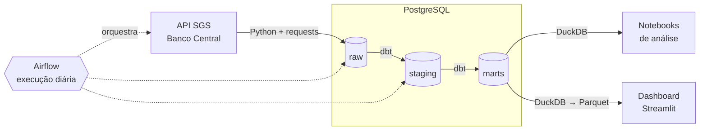

# Pipeline de Indicadores Econômicos (Banco Central)

Pipeline de dados que coleta indicadores econômicos do Brasil na API SGS do Banco Central, armazena em PostgreSQL, transforma com dbt e disponibiliza em um dashboard.

**Indicadores:** Selic, IPCA, dólar (PTAX) e taxa de desemprego.

**Métricas calculadas:** variação mensal, acumulado em 12 meses e Selic real (Selic − IPCA).

## Arquitetura



| Camada | Conteúdo |
|---|---|
| `raw` | Dados exatamente como vêm da API |
| `staging` | Dados limpos e tipados, com nomes padronizados |
| `marts` | Tabelas prontas para análise e para o dashboard |

## Stack

| Etapa | Ferramenta |
|---|---|
| Extração | Python, requests |
| Armazenamento | PostgreSQL (Docker) |
| Transformação e testes de qualidade | dbt |
| Orquestração | Airflow |
| Análise | DuckDB, Jupyter |
| Dashboard | Streamlit |
| CI | GitHub Actions |

**Por que PostgreSQL e DuckDB, e não Spark ou ClickHouse?** As séries somam poucos milhares de linhas. Ferramentas distribuídas adicionariam complexidade sem ganho. PostgreSQL atende bem como banco central, e DuckDB é ideal para análise local e exportação para Parquet.

## Como rodar

Pré-requisitos: Python 3.12+, Docker Desktop e Git.

```bash
git clone https://github.com/Riquenzinho/pipeline-indicadores-bcb.git
cd pipeline-indicadores-bcb

python -m venv .venv
.\.venv\Scripts\Activate.ps1      # Windows (PowerShell)
# source .venv/bin/activate       # Linux/macOS

pip install -r requirements.txt

cp .env.example .env              # depois edite o .env com suas senhas
```

## Roadmap

- [x] Estrutura do projeto e ambiente
- [ ] Extração das séries da API SGS
- [ ] Banco PostgreSQL com camadas raw, staging e marts
- [ ] Transformações e testes de qualidade com dbt
- [ ] Orquestração diária com Airflow
- [ ] Análises com DuckDB
- [ ] CI com GitHub Actions
- [ ] Dashboard publicado no Streamlit Community Cloud

## Fonte dos dados

[Sistema Gerenciador de Séries Temporais (SGS)](https://www3.bcb.gov.br/sgspub/) do Banco Central do Brasil.
